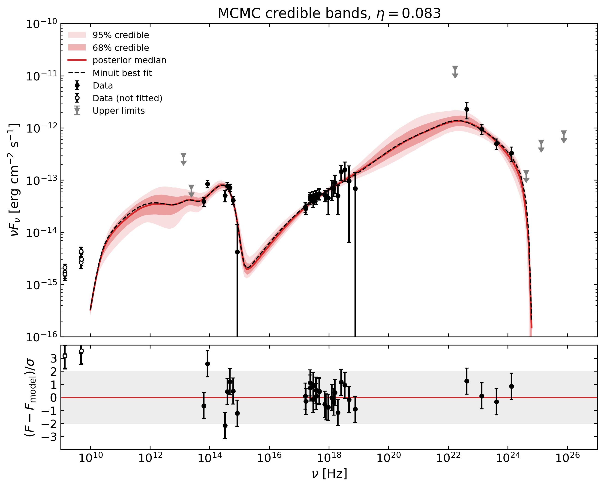
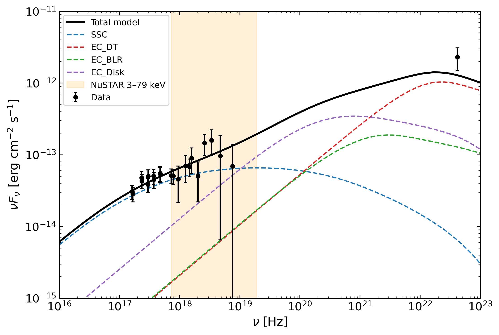
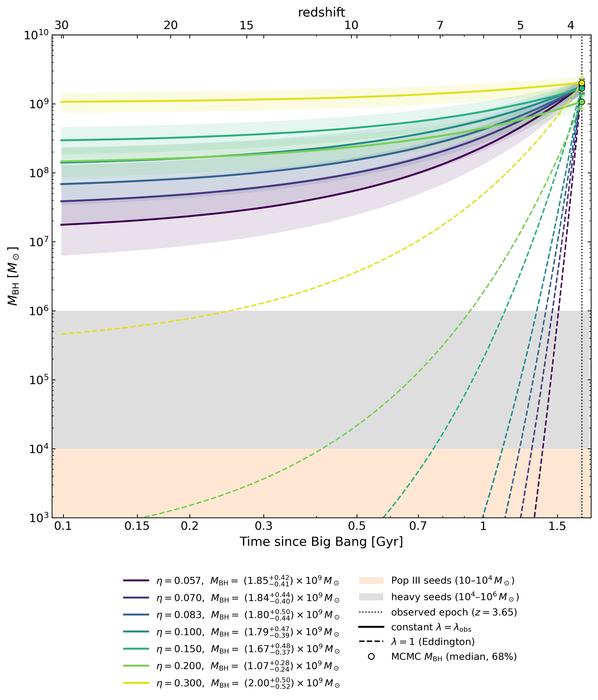

# MG3 J163554+3629: jet physics and black-hole growth at z = 3.65

**[Thesis (PDF)](thesis/Mirza_Laraib_thesis.pdf)** · **[Analysis notebooks](analysis/)** · **[Extensions: UltraNest and a two-zone model](extensions/)**

This repository contains the full analysis of my master's thesis, *Jet Physics of MG3 J163554+3629 and Its Impact on
Supermassive Black Hole Evolution in the Early Universe* (M.Sc. Astrophysics and Cosmology, University of Padova,
2026), supervised by Prof. Eugenio Bottacini and Dr. Andrea Tramacere.

## The question

Some quasars already host black holes of 10⁹ M☉ less than two billion years after the Big Bang, and it is still not
clear how they grew so fast. Blazars help here: their jets point at us, so they are bright enough to be seen at high
redshift, and their spectra carry information about both the jet and the accretion disc that feeds the black hole.

MG3 J163554+3629, at z = 3.65, is one of the most distant blazars detected by Fermi-LAT. I modelled its full spectral
energy distribution, from radio to γ-rays and including new NuSTAR hard X-ray data, to find out what makes its
high-energy emission, how massive its black hole is, how powerful its jet is, and what all of that implies for how the
black hole grew.



## What I did

- **Data.** Radio (VLA, Green Bank), infrared (WISE), optical (Gaia), UV (Swift-UVOT), X-rays (XMM-Newton and
  NuSTAR, 3–79 keV) and γ-rays (Fermi-LAT), with upper limits where the source is not detected.
- **Model.** A one-zone leptonic jet model in [JetSeT](https://github.com/andreatramacere/jetset): synchrotron,
  synchrotron self-Compton (SSC), and external Compton (EC) scattering of photons from the accretion disc, the
  broad-line region and the dusty torus, with absorption by the extragalactic background light.
- **Fitting.** Minuit for the best fit, then MCMC (emcee) for the posterior distributions of the parameters.
- **The accretion efficiency.** The SED alone cannot tell how efficiently the disc radiates, so I repeated every fit
  for seven efficiencies, η = 0.057 to 0.300, which corresponds to black-hole spins from a = 0 to almost 1.
- **Black-hole growth.** For each η, the growth history from a seed black hole at z = 30, together with the energy
  budget of the jet.

## What I found

<table>
<tr>
<td width="50%"></td>
<td width="50%"></td>
</tr>
<tr>
<td>In the hard X-rays the emission changes from SSC to external Compton: NuSTAR is what separates the two.</td>
<td>Growth of the black hole from a seed at z = 30 to the measured mass at z = 3.65.</td>
</tr>
</table>

- **Where the emission comes from.** The SED is well fitted (χ² = 26.3 for 27 degrees of freedom) by a region at
  R_H ≃ 1.2×10¹⁸ cm from the black hole: outside the broad-line region and well inside the dusty torus, with a
  magnetic field B ≃ 0.06 G and a bulk Lorentz factor Γ ≃ 18.
- **SSC versus external Compton.** SSC makes 60–74% of the emission at 10 keV and 37–56% at 40 keV; the rest, and all
  of the γ-rays, is external Compton. This split is the same for every accretion efficiency, so it is a robust result.
- **The central engine.** The disc radiates L_disc ≃ 1.9×10⁴⁶ erg/s, and the black hole mass is
  M_BH = (1.8 +0.5/−0.4)×10⁹ M☉ (for an inner disc radius of about 8 Schwarzschild radii), with an Eddington ratio
  λ ≃ 0.08.
- **The efficiency is not measurable from the SED.** All seven efficiencies fit equally well (Δχ² = 0.76 across the
  grid): in this model η only changes the size of the broad-line region and the torus.
- **Spin, jet power and growth.** The jet carries several times the disc luminosity. Putting the jet power, the growth
  history and the proton content together, the most consistent picture (for one cold proton per ten electrons) is a
  black hole that spins fast but not maximally, a ≈ 0.6–0.7, with a standard disc radiating η ≈ 0.09–0.10, grown from
  a heavy seed at an average Eddington ratio of 0.33–0.47. This is a consistent picture under the stated
  assumptions, not a measurement of the spin.

The full discussion, including the systematic uncertainties, is in Chapter 5 of the [thesis](thesis/Mirza_Laraib_thesis.pdf).

## How to explore it

The notebooks are saved with all their outputs, so you can read them directly on GitHub without running anything.

| notebook | what it does |
|---|---|
| [`01_data_and_template`](analysis/01_data_and_template.ipynb) | the SED, its shape, and the starting model |
| [`02_base_model`](analysis/02_base_model.ipynb) | Minuit fit and MCMC for η = 1/12 |
| [`03_eta_grid`](analysis/03_eta_grid.ipynb) | fits and MCMC for each η; which process makes the X-rays, MeV and GeV emission |
| [`04_bh_growth`](analysis/04_bh_growth.ipynb) | seed mass and growth history for each η |
| [`05_jet_energetics`](analysis/05_jet_energetics.ipynb) | jet powers, proton content, jet power vs disc luminosity |
| [`06_figures_tables_and_slides`](analysis/06_figures_tables_and_slides.ipynb) | tables and figures for the thesis and the defence |

**Extensions.** Before settling on the thesis set-up I also tried two other approaches, kept in
[`extensions/`](extensions/): nested sampling with UltraNest (which also gives the Bayesian evidence), and a two-zone
model that adds an extended region to fit the radio data. They use an earlier version of the data handling, so their
numbers are not directly comparable with the thesis.

| notebook | what it does |
|---|---|
| [`01_one_zone_ultranest`](extensions/01_one_zone_ultranest.ipynb) | the one-zone model sampled with UltraNest |
| [`02_two_zone_model`](extensions/02_two_zone_model.ipynb) | compact zone + extended zone, fitted with Minuit |
| [`03_two_zone_ultranest`](extensions/03_two_zone_ultranest.ipynb) | nested sampling of the two-zone model; Minuit vs MCMC vs UltraNest |
| [`04_comparison_sanchez_zaballa`](extensions/04_comparison_sanchez_zaballa.ipynb) | the two-zone results next to the published one-zone model |

## Running it yourself

```bash
git clone https://github.com/Mirza-751/MG3-J163554-3629-SED-Modelling.git
cd MG3-J163554-3629-SED-Modelling
conda create -n jetset_env python=3.9
conda activate jetset_env
pip install -r requirements.txt
jupyter lab analysis/
```

Run the notebooks in order. The fitted models and MCMC chains are already in `results/`, so they run in a few minutes
without refitting: notebook 02 has `RUN_FIT` / `RUN_MCMC` switches, and notebook 03 skips any η whose results already
exist. Refitting takes about 15 minutes per fit and per MCMC run. Everything was done with JetSeT 1.3.0.

```
thesis/       the thesis (PDF)
data/         SED.txt: the multiwavelength SED
analysis/     the thesis analysis (notebooks 01–06 and mg3_setup.py)
results/      fitted models, MCMC chains, tables and figures
extensions/   UltraNest and two-zone analyses, with their own results
```

## References and acknowledgements

The model set-up follows Sánchez Zaballa, Bottacini & Tramacere (2025), *The high-redshift blazar MG3 J163554+3629:
physical properties and the enigma of its unexpected supermassive black hole growth*, ApJ,
[arXiv:2505.13593](https://arxiv.org/abs/2505.13593). The modelling uses JetSeT by Andrea Tramacere (Tramacere 2020;
Tramacere et al. 2011, 2009). I thank my supervisors, Prof. Eugenio Bottacini and Dr. Andrea Tramacere, for their
guidance throughout this work.

## Contact

Mirza Laraib Mustafa, M.Sc. Astrophysics and Cosmology (University of Padova). If you would like to reuse any part of
the analysis or the results, please get in touch first.
